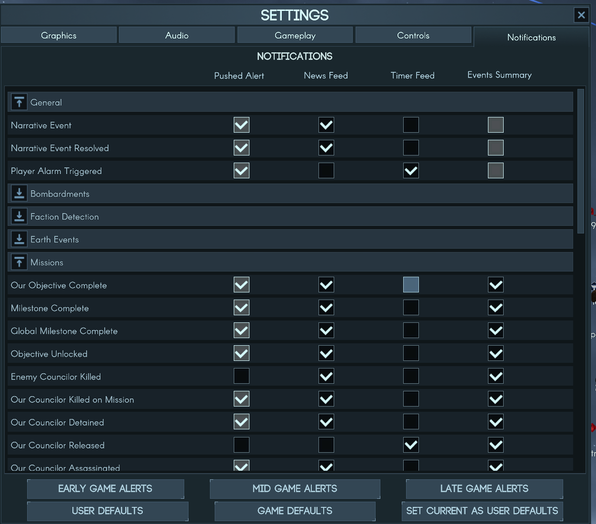

# Notification Presets

A Terra Invicta mod that adds three buttons to the notification settings page, setting which notifications pop up and pause the game for the early, mid and late game.



## Features

- **Early game alerts:** the game's defaults, minus results of missions that can't fail (e.g. Defend Interests)
- **Mid game alerts:** also drops routine news, such as army movements, nations gaining claims or space programs, policy changes, councilor traits, probe arrivals and refuels
- **Late game alerts:** only control points lost, cracked down or purged, coups and revolutions, fleets and habs (incoming fleets, arrivals, losses, ships completed, hab captures and attacks) and the tech-win warning
- Only the Pushed Alert column changes. News feed, timer and summary settings stay as they are, so everything is still logged
- You can still adjust individual notifications afterwards

## Installation

Subscribe on the Steam Workshop, or install by hand. Either way the mod needs [Unity Mod Manager](https://www.nexusmods.com/site/mods/21) (UMM), version 0.24 or later.

1. **Install UMM for Terra Invicta.** Run UnityModManager.exe, pick Terra Invicta from the list, choose the **DoorstopProxy** method and click Install.
   - On Linux/Steam Deck (Proton), also set this Steam launch option for Terra Invicta:
     `WINEDLLOVERRIDES="winhttp=n,b" %command%`
2. **By hand:** build the mod (see below) or download a release, and put `NotificationPresets.dll` and `ModInfo.json` in `Terra Invicta/Mods/Enabled/Notification Presets/`.
3. Start the game. Notification Presets should appear in the UMM window (Ctrl+F10).

## Usage

Open Settings > Notifications during a campaign and click one of the three buttons above the defaults buttons.

Notification settings are saved with each campaign, the same as when you tick them by hand, so apply a preset once per campaign stage. Some notifications can't be changed in the game's settings either, and presets leave those alone.

## Compatibility

Tested on Terra Invicta 1.0.53b. The presets use the game's own notification settings, so removing the mod keeps whatever settings your campaign had.

## Building from source

You need the .NET SDK (6.0 or later; the project targets .NET Framework 4.8 through reference packages) and an installed copy of the game with UMM.

```sh
dotnet build -c Release -p:TIGame="/path/to/Terra Invicta" -p:Deploy=true
```

`TIGame` points at your game folder (the default is the Steam on Linux location). `-p:Deploy=true` copies the built mod straight into `Mods/Enabled`.

## Feedback

Bug reports and suggestions are welcome in [Issues](https://github.com/jingo64/notification-presets/issues).

## License

MIT, see [LICENSE](LICENSE).
